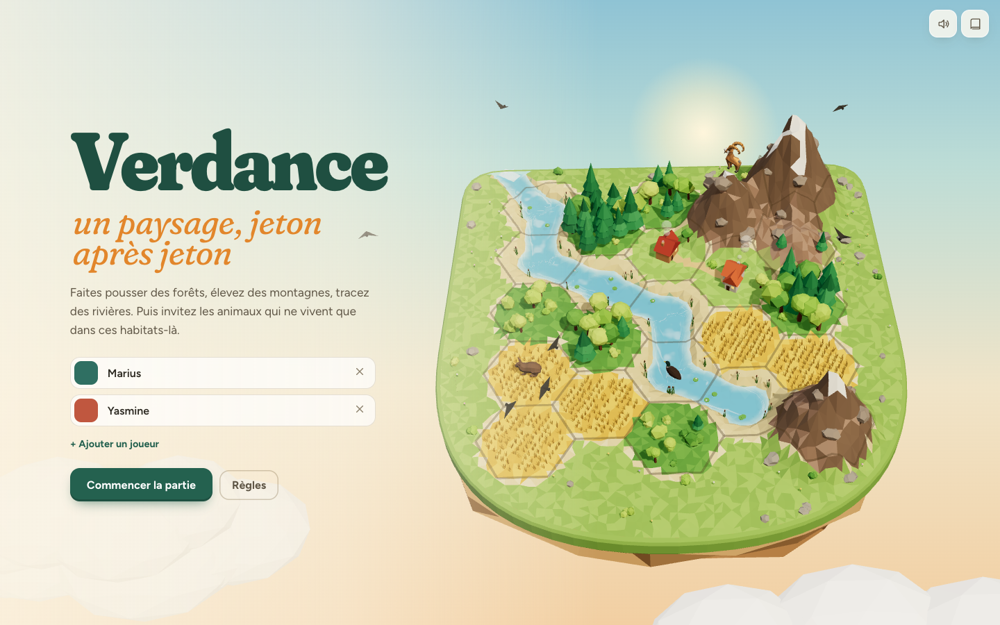
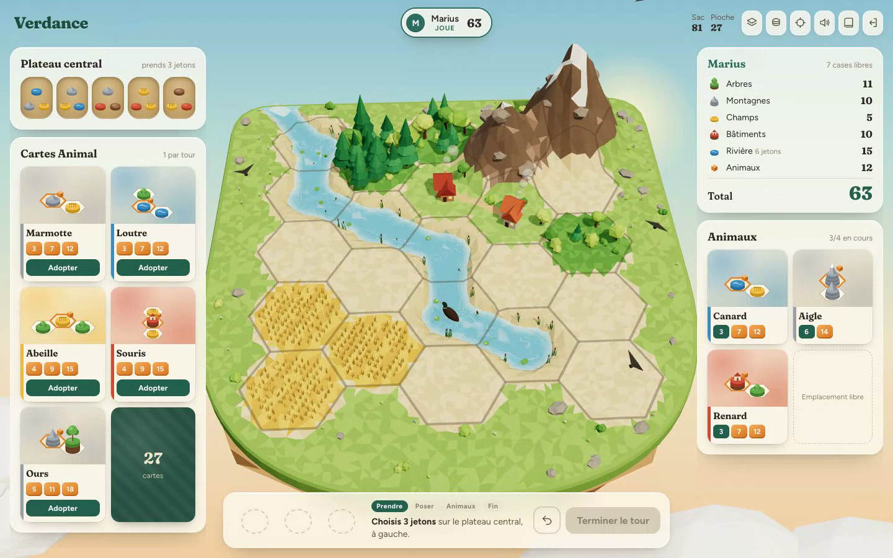

# Verdance

**Un paysage, jeton après jeton.** Un jeu de société en 3D, dans le navigateur : chaque jeton posé sculpte une île flottante. Les montagnes émergent, les rivières se creusent et coulent, les forêts poussent, et les animaux viennent s'installer quand leur habitat est prêt.

*A cozy 3D tile-laying board game in the browser: every token you place sculpts a living floating island. Rivers carve and flow, mountains rise, forests grow, and animals move in once their habitat is ready.*



**[Jouer en ligne](https://mariusfaitducode.github.io/verdance/jouer.html)** · [Page du jeu](https://mariusfaitducode.github.io/verdance/)

## Le jeu

À chaque tour :

1. **Prends 3 jetons** sur le plateau central et pose-les sur ton île.
2. **Adopte une carte Animal** si tu veux (4 en cours au maximum).
3. **Accueille les animaux** dont tu as réalisé le motif, dans n'importe quelle orientation.

Les jetons s'empilent : 1 à 3 gris font une montagne, du vert sur des troncs fait un arbre, un rouge sur une base fait une maison. Les points viennent des paysages (forêts, chaînes de montagnes, champs, hameaux, la plus longue rivière) et des animaux accueillis. La partie s'arrête quand le sac est vide ou qu'une île est presque pleine.

De 1 à 4 joueurs sur le même écran, en 20 à 30 minutes.



## Ce qui rend le monde vivant

- **Terrain procédural** : le plateau est un relief continu recalculé à chaque jeton. Deux montagnes voisines se soudent en chaîne, l'eau creuse son lit et rejoint les cases voisines, et une rivière qui touche le bord se jette dans le vide en cascade.
- **Objets générés** : pins, feuillus, rangs de blé, maisons en bois, pierre ou brique. Tout est construit par le code et légèrement différent à chaque case.
- **Animaux** : 32 modèles 3D qui se promènent, nagent, volent ou se perchent selon leur habitat.
- **Détails** : courant de l'eau, fumée des cheminées, oiseaux, sons synthétisés à la volée.

## Lancer le jeu

Aucune installation. Ouvre `jouer.html` (ou `index.html` pour la page d'accueil) dans un navigateur récent, par double-clic ou via n'importe quel serveur statique :

```sh
python3 -m http.server 8000   # puis http://localhost:8000
```

Une connexion internet est nécessaire au premier chargement (Three.js et les polices viennent d'un CDN).

## Organisation du code

| Fichier | Rôle |
|---|---|
| `rules.js` | Règles pures : placement, motifs des cartes, décompte. Aucun affichage, réutilisable côté serveur. |
| `scene.js` | Le monde 3D : relief, eau, objets, animaux, caméra (Three.js r160). |
| `ui.js` | Interface : plateau central, cartes, main du joueur, sons, sauvegarde locale. |
| `assets/animals.js` | Les modèles d'animaux encodés en base64, pour fonctionner sans serveur. Sources dans `assets/animals/`. |
| `prototype-v1.html` | Premier prototype 2D, autonome. |
| `IDEES.md` | Pistes de variantes et de modes de jeu. |

## Feuille de route

- Saisons qui changent les règles et l'aspect de l'île
- Version en ligne à tour simultané
- Défi du jour (même sac pour tout le monde)
- Version mobile

## Crédits et licences

- **Code** : licence [MIT](LICENSE).
- **Peintures des cartes** : *Atlas de poche des mammifères de France, de la Suisse romane et de la Belgique* (René Martin et collaborateurs, Klincksieck, vers 1910), domaine public, via Wikimedia Commons. Détail dans [`assets/cards/CREDITS.md`](assets/cards/CREDITS.md).
- **Modèles 3D d'animaux** : « Poly by Google » (CC-BY 3.0), « Gwym Hendawyr » (CC-BY 3.0) et « Хмара Сергей » (CC-BY 3.0) via [poly.pizza](https://poly.pizza), et [Quaternius](https://quaternius.com) (CC0). Textures redimensionnées, certains modèles réorientés ou teintés. Le détail fichier par fichier est dans [`assets/animals/CREDITS.md`](assets/animals/CREDITS.md). Ces modèles restent sous leur propre licence, pas sous MIT.
- **Inspiration** : Verdance s'inspire des jeux de pose et de motifs, notamment *Harmonies* de Johan Benvenuto (Libellud). C'est un projet indépendant, sans lien avec Libellud et sans leur approbation. Les cartes et l'univers graphique sont originaux.
